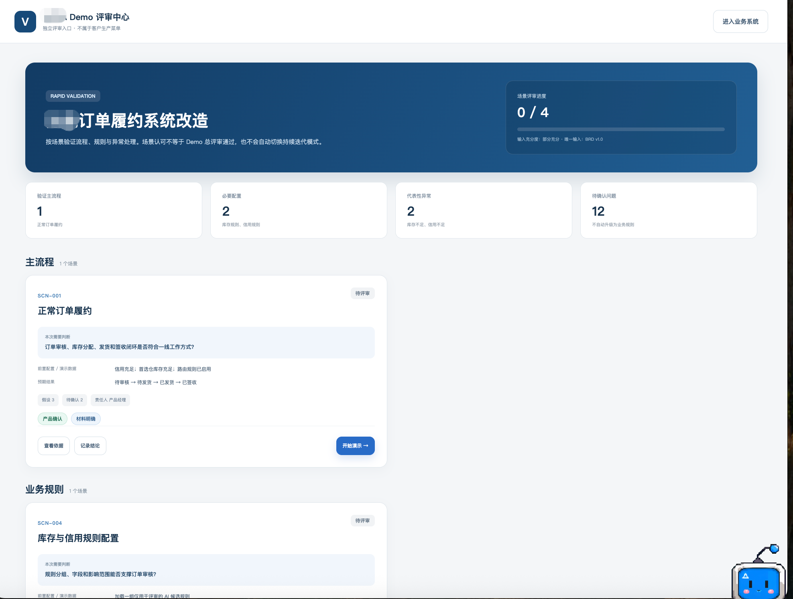
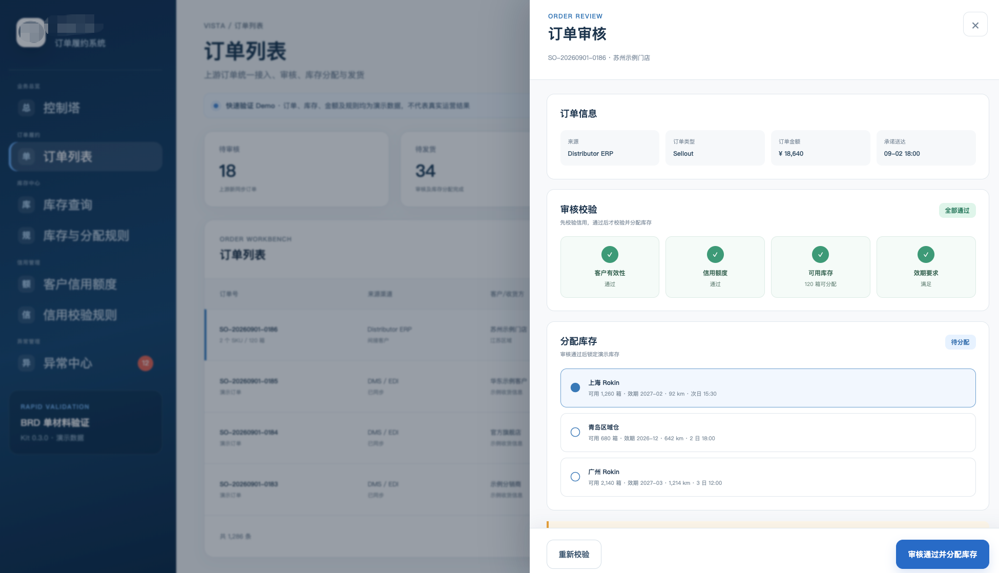
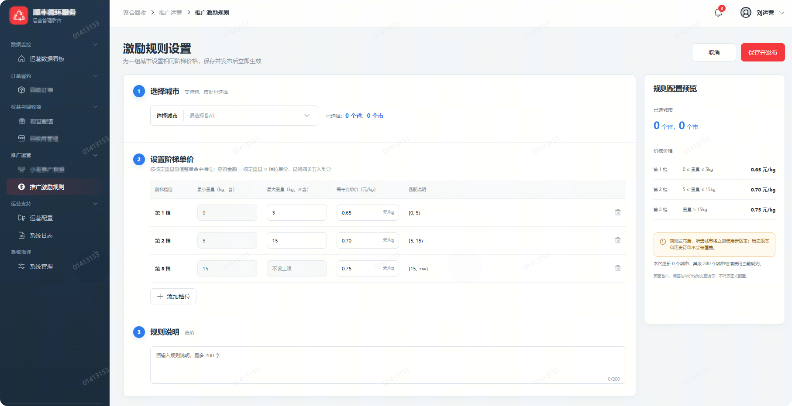
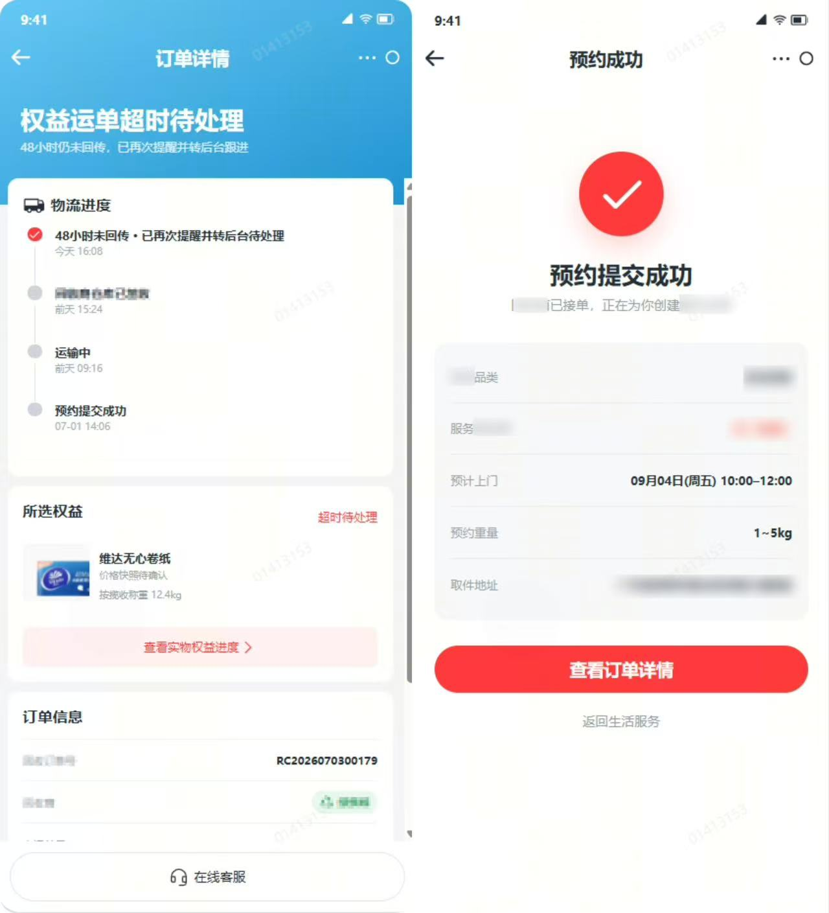

# Engineering Prototype Kit

> 业务材料 + Codex + Engineering Prototype Kit = 可评审 Demo → 可持续迭代的业务原型

[](./package.json)
[](./package.json)
[](./LICENSE)

面向产品经理与 Codex 的 B 端工程化原型工具仓库。它把零散的会议记录、调研材料和 BRD，逐步转化为可运行、可评审、可追溯的前端原型；项目进入持续建设后，再按风险补齐规则、变更、验收和交付治理。

**2 种工作模式 · 12 个材料模板 · 8 个专项 Skills · 10 类护栏测试**

## 它解决什么问题

- 输入材料往往不完整，但客户现场需要尽快看到可操作的 Demo；
- Demo 通过评审后会持续增加功能，不能每轮都从一次性页面重新开始；
- AI 可以分析和执行，但不能替产品经理确认业务规则、范围和上线结论；
- B 端系统不仅需要主流程，还要按评审目标覆盖必要配置、代表性异常、结果反馈和可恢复数据。

Kit 负责把这些约束放进可复用的模板、生成器、Skills 和检查器中。每个真实业务项目会被创建到一个独立、干净的目录，不会复制 Kit 的示例、发布历史和内部设计材料。

## 界面预览

### 从评审场景进入业务系统



评审中心独立于客户生产菜单，用来说明本轮验证什么、从哪里开始演示，以及哪些内容仍属于假设或待确认问题。



进入业务系统后保留评审上下文；列表、状态、操作列和审核抽屉共同构成一条可操作、可反馈的核心流程。

### 更多适用场景

| 复杂规则配置 | 移动端业务流程 |
|---|---|
|  |  |
| 阶梯规则、配置预览和发布操作 | 预约提交结果与订单履约详情 |

以上均为原型示例，用于展示工作方式和界面形态，不代表生产系统或通用业务规则。

## 两种工作模式

| | 快速验证 `rapid-validation` | 持续迭代 `continuous-iteration` |
|---|---|---|
| 适用场景 | 客户现场验证、项目前期 Demo、材料有限时验证方向 | 需求评审后继续建设、旧项目改造、多轮功能迭代 |
| 首要目标 | 尽快暴露对流程、页面和演示方式的理解偏差 | 保持规则、变更、验收和交付结果一致 |
| 默认材料 | 业务基线、评审确认；部分充分或多场景时增加 Demo 蓝图 | 业务基线、决策入口、CR 可读视图；其他材料按风险触发 |
| Demo 完成判断 | 核心流程 + 必要配置 + 代表性异常 + 可见反馈 + 可恢复数据 | 已确认范围实现完成，并具有评审结论和类型化证据 |
| AI 边界 | 推荐目标和方案，不能把假设自动升级为正式规则 | 建议风险和活动，不能自动授权实施、切换模式或完成需求 |

AI 先推荐模式，产品经理负责确认。快速模式只有在需求评审通过或有条件通过、明确继续建设、保留评审证据并再次确认后，才能切换为持续迭代。

## 产品经理：三步开始

### 1. 获取并打开 Kit

可以直接 [下载当前主分支 ZIP](https://github.com/yuxuanliu1238-droid/engineering-prototype-kit/archive/refs/heads/main.zip)，解压后使用 Codex 打开文件夹；也可以让研发按下方方式克隆仓库。

### 2. 只提供本轮材料

把明确要分析的材料放进 `inbox/`，或直接在对话中指出文件。Codex 不应扫描你没有授权的其他业务项目。

### 3. 用自然语言启动

复制下面任一提示词即可。Codex 应负责判断、建项目、安装依赖、运行检查和打开预览；需要你操作时，一次只说明一个步骤。

**一份 BRD，先推荐模式**

> 请只读取我明确提供的这一份 BRD，先判断输入充分度并推荐工作模式。说明已经能确定、仍然缺少、可以继续生成、需要我确认和当前不应做的内容。等我确认后，再用 Engineering Prototype Kit 创建一个干净业务项目；不要扫描其他项目。

**几份会议材料，先识别核心流程**

> 请读取我指定的几份会议材料，先整理业务目标、角色、核心流程和材料缺口。如果存在多条流程，请推荐本轮主要验证目标和必要的辅助场景。此时不要生成 Demo，等我确认分析结果。

**客户调研后生成 Demo 蓝图**

> 请根据我明确提供的客户调研材料，分析可能需要的业务菜单、每个菜单的关键字段和操作，以及它们如何串联。区分材料明确、流程推导、AI 候选和待确认内容，先输出 Demo 蓝图，等我确认结构后再实施原型。

**旧项目进入持续迭代**

> 请只读检查我指定的旧项目，先整理最小业务基线、当前需求影响范围和未审计模块，建议本次变更的风险等级与必要活动。不要直接修改业务正文、原型行为或历史确认，等我授权后再实施。

## 六项核心能力

1. **双模式工作流**：同一套 Kit 支持前期快速验证和评审后的持续建设；
2. **输入充分度判断**：把输入分为充分、部分充分、不充分，不充分时只做业务探索；
3. **Demo 蓝图**：先梳理菜单、页面、字段、操作、流程、规则和异常，再决定实现范围；
4. **独立评审中心**：按场景进入业务系统，评审上下文和返回入口贯穿内部菜单；
5. **B 端默认呈现**：提供工作台、列表、状态、操作列、规则配置和异常中心的中性结构；
6. **变更与交付护栏**：五阶段 CR、三级风险、动态活动、模式切换、迁移和升级均保留人工门禁。

## 输入充分度与预期产出

| 判断 | Codex 可以继续做什么 | 不可以做什么 |
|---|---|---|
| 充分 | 形成确认范围内的 Demo 或持续迭代方案 | 擅自扩大业务范围 |
| 部分充分 | 输出 Demo 蓝图，用明确假设构建可评审部分 | 把缺失规则伪装成正式结论 |
| 不充分 | 整理事实、假设、问题和下一轮调研建议 | 创建 Demo 项目或启动实施 |

完成的 Demo 不以页面数量判断，而看是否服务本轮验证目标，并覆盖目标触达的核心流程、必要配置、代表性异常、可见反馈和可恢复数据。

## 开发者与维护者

```bash
git clone https://github.com/yuxuanliu1238-droid/engineering-prototype-kit.git
cd engineering-prototype-kit
pnpm install
pnpm check
pnpm build:review
pnpm build:kit-release
```

`pnpm build:review` 用于完整检查和原型生产构建；`pnpm build:kit-release`（兼容入口为 `pnpm build:delivery`）会生成正式 Kit ZIP，只在用户明确要求交付时运行。

源码指纹和 Markdown 评审包使用项目内通用脚本生成，规则见 `docs/review/evidence-and-review-packages.md`。隔离测试不读取宿主项目的业务台账、页面 ID 或文案。

## 版本与目录名

- `package.json.version` 是套件版本的唯一权威，`project.config.json.kitVersion` 必须与它一致。
- 目录名不是套件版本权威；历史目录名称只用于迁移追溯。
- 正式发布包由脚本按当前包版本命名；目录重命名属于独立迁移，不在普通版本升级中自动执行。
- pnpm、Node、独立锁文件和宿主项目兼容边界见 [`docs/technical-review/package-manager-compatibility.md`](docs/technical-review/package-manager-compatibility.md)。

常用命令：

- `pnpm project:create -- ...`：创建独立业务项目；评审目标和输入判断应由 Codex 整理、产品经理确认；
- `pnpm project:switch-mode -- --project <目录> ...`：默认只预览，增加 `--apply` 才切换模式；
- `pnpm project:migrate -- --project <目录> --mode continuous-iteration --confirmed-by <确认人>`：默认只生成 V0.2 → V0.3 影响报告；
- `pnpm project:upgrade -- --project <目录>`：默认只生成 Kit 升级预览；
- `pnpm build:kit-release`：生成完整 Kit 发布包；
- 业务项目中的 `pnpm package:review`：只生成该业务项目的评审交付包。

## 仓库结构

```text
engineering-prototype-kit/
├── templates/    # 干净业务项目的材料与运行时模板
├── skills/       # 业务探索、决策、页面契约、质量和交付协作说明
├── scripts/      # 创建、校验、迁移、升级和发布工具
├── examples/     # 匿名教学示例，不作为真实业务事实
├── docs/         # 产品模型、材料体系、需求视图和验证记录
├── prototype/    # Kit 自身的中性说明原型
└── inbox/        # 明确授权给 Codex 的输入材料入口
```

## 按角色阅读

| 你是谁 | 建议先看 |
|---|---|
| 第一次使用的产品经理 | [START-HERE.md](./START-HERE.md) |
| 需要理解两种模式 | [V0.3 产品模型](./docs/design/v0.3-product-model.md) |
| 需要理解材料为什么增减 | [V0.3 材料体系](./docs/design/v0.3-material-system.md) |
| 需要查看需求与变更状态 | [需求台账可读视图](./docs/requirements/requirements.md) |
| 维护或发布 Kit | [V0.3 验证记录](./docs/review/v0.3-verification.md) 与 [AGENTS.md](./AGENTS.md) |

## 它能加速，但不会替你做业务决定

- AI 推荐评审目标、模式、风险和活动，产品经理负责确认；
- 形式认可、场景认可、业务规则确认和需求总评审分别生效，不能互相替代；
- 未确认的内容必须保留为假设、推导、候选或待确认问题；
- 默认只建设前端工程化原型，不包含生产级后端、数据库、真实鉴权和生产部署；
- 飞书、Jira 等外部连接器不属于 V0.3，外部确认先使用统一证据模型记录。

## 已验证范围

V0.3 已通过匿名 B 端新项目的快速验证回放、旧项目的轻量/标准/高风险需求回放，以及模式门禁、动态活动、迁移、恢复、升级保护、业务实例生成和前端生产构建检查。

八个项目内 Skills 的唯一主职责、候选 Skill 结论和确定性脚本边界记录在 `skills/skill-boundaries.json`，并由 `pnpm skills:validate` 校验。

这些验证用于确认流程边界、材料精简和工具行为正确，不用于宣称真实项目已经节省了固定时间或成本。完整记录见 [V0.3 验证报告](./docs/review/v0.3-verification.md)。

## 当前版本

当前发布候选版本为 **V0.3.0**。V0.4 尚未立项；后续版本只有在范围确认和明确授权后才会开始。

## License

本项目采用 [MIT License](./LICENSE)。
